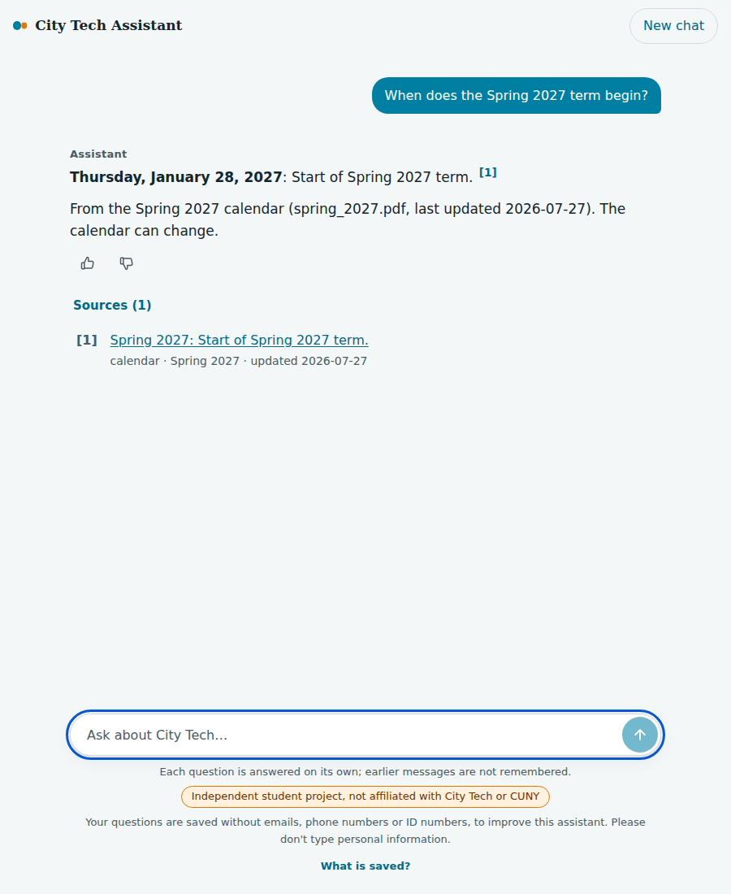
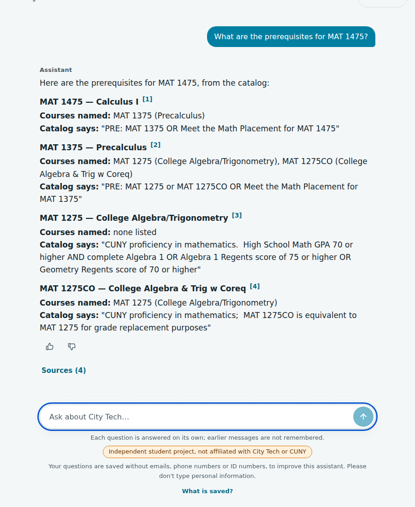
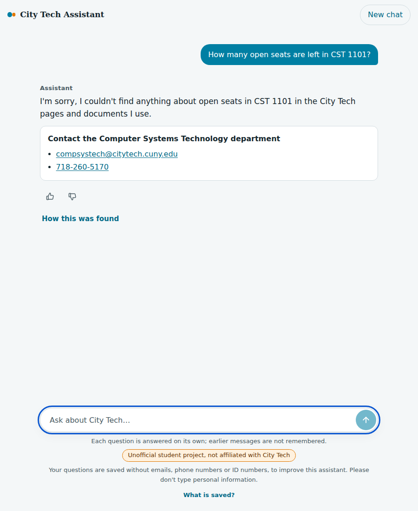
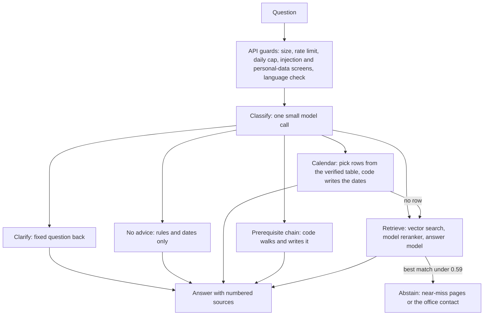

# City Tech Assistant

A question-answering assistant for City Tech (CUNY) students. It answers questions about registration, deadlines, advising, tuition and payment, financial aid, and four departments, and it shows the source for every answer. When the sources do not cover a question, it says so and points to the office to contact.

Status: runs locally; not deployed; no public demo.

**This is an independent student portfolio project. It is not affiliated with or endorsed by City Tech or CUNY, and it is not an official source.** It never uses student data: no login, no CUNYfirst, no Brightspace, nothing about any person's account. Check anything important with the office itself.

## What it does

- Answers from public City Tech pages, catalog data and PDFs that I collected (619 indexed pieces: 197 courses, 413 page and PDF sections, 9 contact records) and from a calendar table of 136 events that I checked by hand against the term calendar PDFs.
- Calendar questions are answered from that table by code, not by searching text. Prerequisite chains are walked and written by code.
- Every answer carries numbered sources. If the sources do not cover the question, it abstains and names the office when one clearly applies.
- It states rules and dates. It does not give advice ("should I drop this class?").
- Covers Fall 2026, Winter 2027 and Spring 2027 calendars and four departments (Computer Systems Technology, Mathematics, Electrical and Telecommunications Engineering Technology, Dental Hygiene). Anything else it declines.

| Calendar answer | Prerequisite chain | Abstain, with the office |
|---|---|---|
|  |  |  |

Example (real output of the final system, 16 Oct 2026):

> **Thursday, January 28, 2027**: Start of Spring 2027 term. [1]
> From the Spring 2027 calendar (spring_2027.pdf, last updated 2026-07-27). The calendar can change.

`[1]` points to the calendar row it came from, shown under "Sources" on the page.

## Results at a glance

[owner: add demo video link, optional]

The final run was done once, on the 31 held-out test questions, with the code frozen at the git tag `final-run-frozen`. The test split is not untouched, though: it had also been run three times before, with earlier configurations (`baseline-final` on 10 questions, `ms1-old` and `ms1-new` on all 31, in milestone 1), and I read those results. Details are under "What these numbers do and do not say". The numbers below are printed by `scripts/readme_numbers.py` from the committed files in `eval/results/`; all tables are in [docs/results.md](docs/results.md). Two of the test questions ("clarify or answer every branch" gold answers) cannot be graded by my harness. I graded them myself after seeing the results, so I show the headline both ways.

| Answer correctness (normal-gold questions) | n | correct | partial | incorrect |
|---|---|---|---|---|
| harness-only | 13 | 10 | 3 | 0 |
| with owner grades for q50, q74 (owner-graded after seeing results) | 15 | 11 | 4 | 0 |

- Faithfulness (judge says the answer is supported by its sources): 13 of 13
- Abstention on questions that must abstain: 7 of 7; wrongly abstained: 0 of 14
- Citation rate: 1.00 (n=23), invalid citations 0
- Retrieval on the 14 retrieval-scored questions: recall@5 0.738, precision@5 0.314, hit@5 0.857, MRR 0.811
- Cost of one request to the assistant (classifier, selector, reranker, answer call and query embedding; no judge): $0.00040
- Cost of the whole eval run including the judge: $0.081 ($0.0026 per request; answers $0.0123, judge $0.0684)
- Latency: median 2.3 s, p95 7.9 s
- Judge pass 2 (same judge, same rubric, answers re-judged): 13 of 14 questions agree on both verdicts; differs: q02 (the log stores the answer with public contact details redacted, so pass 2 saw redacted text)
- Judge cost pass 2: $0.0692

How the system improved on the development set (the set I tuned on). The baseline is Phase 2, vector search only:

| Run | n normal | correct | partial | incorrect | faithful | abstained when it must | wrongly abstained | hit@5 | MRR |
|---|---|---|---|---|---|---|---|---|---|
| Phase 2 baseline (40 dev questions, vector search only, rubric v3) | 26 | 17 (65%) | 7 | 2 | 23 of 26 | 5 of 5 | 3 of 28 | 77% | 0.68 |
| Final configuration, the same questions | 26 | 20 (77%) | 6 | 0 | 24 of 26 | 5 of 5 | 1 of 28 | 97% | 0.93 |
| Final configuration, all 91 dev questions | 52 | 34 (65%) | 7 | 11 | 48 of 52 | 12 of 12 | 12 of 57 | 95% | 0.87 |
| Final configuration, dev questions without the casual-wording group | 37 | 30 (81%) | 6 | 1 | 35 of 37 | 10 of 10 | 2 of 41 | 93% | 0.89 |

Test against dev:

| Set | n normal | correct | faithful | recall@5 | hit@5 | MRR | wrongly abstained |
|---|---|---|---|---|---|---|---|
| dev (the set I tuned on) | 52 | 34 (65%) | 48 of 52 | 0.85 | 0.95 | 0.87 | 12 of 57 |
| test (final run, code frozen) | 13 | 10 (77%) | 13 of 13 | 0.74 | 0.86 | 0.81 | 0 of 14 |
| dev without the casual-wording group | 37 | 30 (81%) | 35 of 37 | n/a | 0.93 | 0.89 | 2 of 41 |

What these numbers do and do not say:
- It is strong on well-formed questions. On the test set nothing unfaithful, nothing wrongly refused, and every must-abstain question abstained.
- It is weak on casual wording. Of the 20 casual-wording dev questions (q104 to q123, for example "payment plan?" or "fafsa deadline"), 15 ask for a fact from the sources: 4 were answered correctly, 1 partly, and 10 were refused (all 10 wrong answers are refusals). The other 5 (a clarify, a no-advice, a calendar-only and two must-abstain questions) are scored by rule and all pass, so 9 of 20 pass overall. The older "4 of 14, 29%" figure is the baseline of the casual round, run before the twentieth question was added. The test set has no casual wording, so the test headline describes well-formed questions only. That is why the dev table shows an 81% row without the casual group next to the 65% row with it.
- The test set is small. 13 normal-gold questions means one question moves the rate by about 8 points.
- The test split is not fully independent. Milestone 1 (13 Oct) was planned as report-only, with no keep rule and no tuning, and nothing in the settings was changed to fit those results. But I read the results, and two later plans name two test failures as their examples: q43 (two course codes, which led to two-course prerequisite answers) and q48 (the contact line read as advice, which fed the no-advice work). Both went from incorrect in `ms1-new` to correct in the final run, so the test result for those two questions is not independent and may be optimistic. Details: `docs/decisions.md`, "Corrections after review".
- Dev is lower than test mainly because of the casual questions. I see no sign of overfitting to dev, but 13 questions cannot prove that.
- The final run measures the pipeline. The API guardrails (rate limits, injection screening, personal-data handling, distress replies) are covered by unit tests and two rounds of outside testers, not by this run.

## How it works



- Classification, calendar row choice, reranking and answers use `gpt-6-luna`; embeddings use `text-embedding-3-small`; the evaluation judge is a different model, `gpt-5.6-terra`.
- Answer settings: temperature 0.1, top_p 0.3, reasoning off; router calls use temperature 0; the judge uses temperature 0.
- Calendar answers come from a table of 136 events I verified row by row. A model only chooses which rows apply; plain code writes every date, weekday and source line.
- Prerequisite chains are walked from the catalog text by code (depth at most 4, at most 15 courses) and rendered by code with the catalog's own words quoted.
- Retrieval: vector search for 20 candidates, a model reranks them, the top 5 go to the answer model. Chunks follow headings and keep tables with their intro text.
- The answer is refused when the best vector similarity is under 0.59. I chose that cutoff on dev only and did not change it after the test split; a sweep showed no cutoff separates a valid short question from an out-of-scope one.
- Near-miss helper: a refusal within 0.04 below the cutoff lists up to two closest pages. It still counts as an abstention and claims nothing about what the pages say.
- Abstentions add an office contact only when one clearly applies (a named department, an account word, a calendar abstention). Contacts come from `config/contacts.yaml`, never from the model.
- Not built on purpose: no conversation memory (each question stands alone), no seats, sections or instructors, nothing behind a login.

## Safety and cost controls

- Daily spend cap of $1.00 and a kill switch (config or a file), per visitor rate limits of 10 a minute and 100 a day (kept in memory, addresses hashed with a random salt, never stored), 15 s per model call, 45 s per request.
- Input handling: control and hidden characters removed; prompt-injection phrases blocked with a fixed reply; emails, phone and ID numbers redacted; Social Security number shaped input refused; a name after "my name is" removed.
- Distress and stress phrases get a fixed, kind reply that names 988 for the narrow cases. It is phrase matching and can miss other wording (known limit).
- Questions in other languages get a short English notice that the assistant answers in English only; the safety screens run on a translation first.
- Logs hold the redacted question and answer, sources, cost and latency, no IP address and no account identifier; a purge command deletes rows older than 30 days. The page says not to type personal information.
- Optional LangSmith tracing exists for development, off by default, and scrubs every payload. Turning it on for a public deployment would be a separate decision.
- No login, no cookies, no analytics, no student data. The API listens on 127.0.0.1 only.
- Crawling: robots.txt respected, at most 1 request per second, an identifying User-Agent, only the allowed hosts in `config/sources.yaml`, never login links, raw responses saved with a content hash.

## What I tried that did not work

Every experiment had its keep rule written down before the run. Details and links are in [docs/results.md](docs/results.md).

| Experiment | Result |
|---|---|
| Stronger answer model (gpt-6-sol) | Correct share 0.859 against 0.923; about 5.5 times the cost. Rejected. |
| Formatting rule for multi-date answers (two rounds) | Both rounds failed their rules (six answers turned into bullet lists; then 4 of 81 changed against a limit of 3). Off. |
| Answering non-English questions from a translation | Failed its rule (hard failures in three of five languages). The assistant replies in English that it answers in English only. |
| Fallback query rewrite for casual questions | Failed twice. The second time a question that must not be answered with one case was answered in 3 of 3 runs. Off. |
| Lowering the 0.59 cutoff | No cutoff separates valid from out-of-scope questions. Unchanged; I added the near-miss reply instead. |
| Hybrid keyword search, department filter | Rejected by their rules. Code kept, off. |

## Where it still fails

From the test run (details in [docs/results.md](docs/results.md)):
- q07, EET degrees: a retrieval miss; the Accelerator Science and Technology minor was left out.
- q41, steps before EET 4202: the chain walk stops at depth 4, so the judge marked it partial.
- q60, TAP waiver: right sources, but the answer left out how to request it.
- q74, last day to drop (my grade, given after seeing results: partial): it lists the three grade-related dates and leaves out the tuition-refund dates unless the question mentions a refund. That is a trade-off I chose and have not fixed.
- q50, refund when dropping (my grade, given after seeing results: correct): complete Fall 2026 schedule; it does not say other terms differ.

Known limits, condensed (full list in [docs/known-limits.md](docs/known-limits.md)):
- A question with two parts answers one part without saying so.
- Casual or very short wording can score under the 0.59 cutoff and get "I could not find this" or the closest pages. No data covers "how to register" or "where to pay" questions.
- Courses outside the four departments, other terms, seats and instructors are not covered.
- Distress detection and name removal are pattern matching and can miss.
- The rate limit counts per network address in memory, so it resets on restart.
- Tuition due dates come out as one long sentence.

## What I would do next

A "version 2", measured on fresh questions I write myself, never on the test split:
- Include the refund rows for an unqualified "last day to drop" question.
- Say that refund schedules differ by term and mention that fees are not refundable.
- Fix casual wording failures (q107, q108, q111, q123 and the casual dev group).
- Retrieve the EET degrees page chunks together (q07); follow prerequisite chains past depth 4 or say what was cut (q41).
- Answer both parts of a two-part question; remove names not written after "my name is".

## How to run it

This is not a one-command reproduce. The collected data is not in the repo, and I did not re-run every step while writing this.

Prerequisites: Python 3.12, [uv](https://docs.astral.sh/uv/), Docker, Node 22, an OpenAI API key.

```bash
uv sync
cp .env.example .env                        # set OPENAI_API_KEY, POSTGRES_PASSWORD, CTA_CONTACT_EMAIL
docker compose up -d                        # Postgres 17 with pgvector, on 127.0.0.1:5432
uv run python -m cta.index.db migrate       # create the tables
```

Data. `data/raw`, `data/processed` and `data/pdfs` are not committed. Only `data/calendar/calendar_events.json` is. To rebuild the data:
1. Download the 11 PDFs listed in `config/sources.yaml` by hand into `data/pdfs/` (department PDFs, term calendars and four office PDFs; the calendar PDFs are linked from the Registrar's academic calendar page).
2. Crawl: `uv run python -m cta.crawl.catalog` and `uv run python -m cta.crawl.pages`. My fetch log has 409 requests; at one per second that is at least about 7 minutes. I did not time a fresh crawl.
3. Parse: `uv run python -m cta.parse.pages`, `cta.parse.pdf_docs`, `cta.parse.departments`, `cta.parse.calendar_build` (each `uv run python -m ...`).
4. Check: `uv run python -m cta.validate` (nothing is indexed until it passes).
5. Index: `uv run python -m cta.index.load --dry-run`, then `--yes` (about 136,000 tokens, roughly $0.003 of embeddings), then `uv run python -m cta.index.load_calendar --yes`.

Run:

```bash
uv run python -m cta.api                    # API on 127.0.0.1:8000 (see /health and /docs)
npm install --prefix web
npm run dev --prefix web                    # page on http://127.0.0.1:3000
```

I checked these against the repo while writing: `uv sync`, `cta.validate`, `cta.index.load --dry-run`, `cta.index.load_calendar --dry-run`, `cta.index.db status`, `cta.index.chunks --stats`, starting the API and the built web app, `pytest`, `npm test`, `tsc` and `next build`. I did not re-run the crawl, parse, `migrate`, `load --yes` or `load_calendar --yes` commands for this README; they are taken from the module docstrings.

## How I built and evaluated it

- 122 eval questions: 91 development, 31 test. I wrote or reviewed every question and gold answer. Gold labels point to a source page and section, not to chunk ids.
- Every change had a keep rule written in `docs/decisions.md` before the run. Dev is for tuning; the final test run was done once at the end, with the code frozen at a tag (the test split had also been run in milestone 1; see the note under "Results at a glance").
- Metrics: recall, precision, hit rate and MRR at k; judged correctness and faithfulness; abstention accuracy; cost; latency. The judge model differs from the answer model. Judge noise is about 0.03 to 0.05 on dev, so I judged the final answers twice: 13 of 14 agreed, and the one difference came from redacted contact details in the stored answer, not from the judge.
- I built this with Claude Code as a coding assistant. I made the decisions, wrote or reviewed every eval question and gold answer, and set the pre-registered rules.

## Repo layout, tests, license

- `src/cta/`: `crawl`, `parse`, `index` (chunks, embeddings, search), `graph` (router, calendar, chain), `api` (FastAPI and guards), `eval`, `validate`.
- `web/` the Next.js page; `config/` settings and sources; `db/migrations/`; `eval/` questions and result files; `scripts/`; `docs/` decisions, plans and results.
- Tests: 2,769 Python tests (`uv run pytest`) and 110 web tests (`npm test --prefix web`); `ruff check` is clean.
- License: MIT for the code (see [LICENSE](LICENSE)). No crawled City Tech content is included. `eval/questions.jsonl` quotes short passages from public City Tech pages in its gold answers; the project is not affiliated with City Tech or CUNY.

## Contact
owner: https://github.com/medrees-1000
