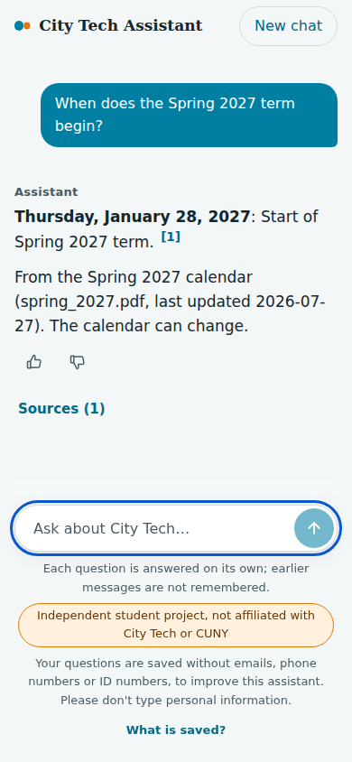
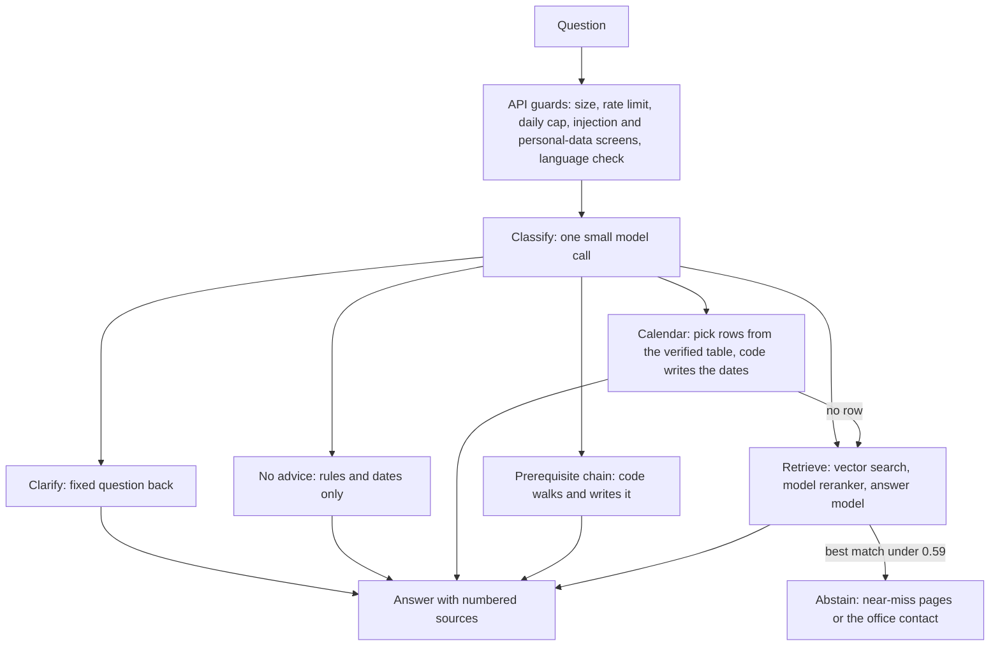

# City Tech Assistant

[](https://github.com/medrees-1000/city-tech-assistant/actions/workflows/ci.yml)

A retrieval-augmented question-answering assistant for City Tech (CUNY) students that cites its sources and says it does not know when the sources do not cover a question.

Built with: Python 3.12, FastAPI, LangGraph, Postgres with pgvector, OpenAI models, Next.js.

Status: runs locally; not deployed. There is a recorded walkthrough (linked below) instead of a live demo.

Independent student portfolio project. Not affiliated with or endorsed by City Tech or CUNY, and not an official source. No login and no student data. Check anything important with the office.

Demo (about 3 minutes): [watch the walkthrough](https://youtu.be/BrpqzHRU3pc)

## Highlights

- Calendar dates come from a table I verified by hand and are written by code, not by the model.
- On the held-out test run (31 questions, code frozen first): 0 incorrect and 0 unfaithful among the judged answers, every must-abstain question abstained, 0 of 14 wrongly refused; about $0.0004 per request, median 2.3 s.
- Casual wording was the weak spot (4 of the 15 fact questions in my 20-question casual set were answered correctly; the misses were refusals). Version 2 adds a rescue rule, now on: of the 11 previously refused casual dev questions, 8 are now correct, 2 partial and 1 still refused (harness judge). On 41 new casual questions I wrote and graded by hand (not fully blind), the 7 clearly answerable ones went from 2 correct-or-partial to 6 (see below).
- Each experiment had a rule written before the run; the failed ones are listed below.

## What it does

- Answers questions about registration, deadlines, advising, tuition and payment, financial aid, and four departments (Computer Systems Technology, Mathematics, Electrical and Telecommunications Engineering Technology, Dental Hygiene), for the Fall 2026, Winter 2027 and Spring 2027 calendars.
- Answers from public City Tech pages, catalog data and PDFs that I collected (619 indexed chunks: 197 courses, 413 page and PDF sections, 9 contact records) and from a calendar table of 136 events that I checked by hand against the calendar PDFs.
- Every answer carries numbered sources. If the sources do not cover the question, it abstains and names the office when one clearly applies.
- It states rules and dates. It does not give advice ("should I drop this class?"), has no conversation memory, and never sees an account.

| Calendar answer | Prerequisite chain | Abstain, with the office |
|---|---|---|
|  |  |  |

On a phone (390 px wide): 

Real output of the final system (16 Oct 2026); `[1]` points to the calendar row it came from:

> **Thursday, January 28, 2027**: Start of Spring 2027 term. [1]
> From the Spring 2027 calendar (spring_2027.pdf, last updated 2026-07-27). The calendar can change.

## Results

Final test run: 31 held-out questions, code frozen at the git tag `final-run-frozen`. Numbers are printed by `scripts/readme_numbers.py` from the committed files in `eval/results/`; all tables are in [docs/results.md](docs/results.md).

| Answer correctness (normal-gold questions) | n | correct | partial | incorrect |
|---|---|---|---|---|
| harness-only | 13 | 10 | 3 | 0 |
| with owner grades for q50, q74 (owner-graded after seeing results) | 15 | 11 | 4 | 0 |

- Faithfulness (judge says the answer is supported by its sources): 13 of 13
- Abstention on questions that must abstain: 7 of 7; wrongly abstained: 0 of 14
- Citation rate: 1.00 (n=23), invalid citations 0
- Retrieval on the 14 retrieval-scored questions: recall@5 0.738, precision@5 0.314, hit@5 0.857, MRR 0.811
- Cost of one request to the assistant (classifier, selector, reranker, answer call and query embedding; no judge): $0.00040
- Cost of the whole eval run including the judge: $0.081 ($0.0026 per request; answers $0.0123, judge $0.0684)
- Latency: median 2.3 s, p95 7.9 s
- Judge pass 2 (same judge, same rubric, answers re-judged): 13 of 14 questions agree on both verdicts; differs: q02 (the log stores the answer with public contact details redacted, so pass 2 saw redacted text)
- Judge cost pass 2: $0.0692

Retrieval metrics cover only the 14 test questions that have a section-level gold source. On the development set (the set I tuned on), baseline against final:

| Dev run | fact questions | correct | hit@5 | MRR |
|---|---|---|---|---|
| Phase 2 baseline (40 questions, vector search only) | 26 | 17 (65%) | 77% | 0.68 |
| Final configuration, the same questions | 26 | 20 (77%) | 97% | 0.93 |
| Final configuration, all 91 questions | 52 | 34 (65%) | 95% | 0.87 |
| Final configuration, without the casual-wording group | 37 | 30 (81%) | 93% | 0.89 |

### Version 2: casual wording on a held-out set

41 casual questions I wrote (typos kept), labeled before the run and never used to tune anything: 7 clearly answerable, 12 uncertain (thin data), 22 that must be refused. The same questions were run once with the rescue rule off and once with it on, and I graded every answer by hand with a written rule. The grading was not fully blind: the two answers were shown without labels, but the run's counts let me infer the configuration for about six questions (`docs/decisions.md`, "Version 2 result and decision").

| Outcome (41 questions) | Rescue off | Rescue on |
|---|---|---|
| correct | 22 | 26 |
| partial | 2 | 5 |
| acceptable refusal (uncertain questions) | 12 | 9 |
| incorrect | 0 | 0 |
| wrongly refused (answerable question) | 5 | 1 |

Seven questions changed, all toward an answer. The 22 must-refuse questions came out the same in both runs (21 correct, 1 partial). The rule: when the best similarity is between 0.45 and the 0.59 cutoff and the reranker's top score is at least 8, the answer model gets to look at the question (it can still refuse). Cost per request rose 13% (about $0.0026 to $0.0029 including the judge). Not every pre-registered rule passed as written (the cost cap and two rule wordings did not); I adopted the rule anyway and recorded each deviation. With only 7 clearly answerable questions this result is directional, not a measured rate.

## Evaluation honesty

- **The test split is not untouched.** The final run was done once, with the code frozen. The split had also been run three times before, with earlier configurations (`baseline-final` on 10 questions, `ms1-old` and `ms1-new` on all 31, in milestone 1). Milestone 1 was planned as report-only, and I changed no setting to fit it. But I read those results, and two later plans name two test failures as their examples: q43 (two course codes, which led to two-course prerequisite answers) and q48 (the contact line read as advice, which fed the no-advice work). Both went from incorrect to correct, so the test result for those two is not independent and may be optimistic (`docs/decisions.md`, "Corrections after review").
- **Two test questions were graded by me, after seeing the results.** q50 (correct) and q74 (partial) have "clarify or answer every branch" gold answers that my harness cannot grade, so the table shows both views.
- **The test set is small.** 13 fact questions means one question moves the rate by about 8 points. I see no sign of overfitting to dev, but 13 questions cannot prove that. Dev is lower than test mainly because of the casual-wording questions.
- **Casual wording.** The casual set is 20 dev questions (q104 to q123). Of the 15 fact questions, 4 were answered correctly, 1 partly and 10 were refused (every wrong answer is a refusal); the other 5 are scored by rule and all pass, so 9 of 20 pass. The older "4 of 14, 29%" is the baseline of the casual round, run before the twentieth question was added. The test set has no casual wording. These dev numbers were measured before the rescue rule; with the rescue on, 8 of the 11 previously refused casual dev questions are correct, 2 partial and 1 (q108) is still refused (harness judge, `cv2-dev-fix`).
- **The headline test-split numbers were measured before the rescue rule existed** (tag `final-run-frozen`). The live app now runs with the rescue on, measured separately on the held-out casual set above and on the casual dev questions, not on the test split.
- **The q74 fix was checked by replay and unit tests only, not on fresh questions.** Since Oct 17, 2026 a drop or withdraw answer also lists the tuition-refund rows from the verified calendar. The dev question q114 was relabelled after the diagnosis was seen, so it is not a clean test of the fix; the frozen test numbers are unchanged and the test split was not rerun (`docs/decisions.md`, "q74: refund rows in drop and withdraw answers").
- **The final run measures the pipeline.** The API guardrails (rate limits, injection screening, personal-data handling, distress replies) are covered by unit tests and two rounds of outside testers, not by this run.

## How it works



- Classification, calendar row choice, reranking and answers use `gpt-6-luna`; embeddings use `text-embedding-3-small`; the evaluation judge is a different model, `gpt-5.6-terra`. Answer settings: temperature 0.1, top_p 0.3, reasoning off; router calls and the judge use temperature 0.
- A model only chooses which calendar rows apply; plain code writes every date, weekday and source line.
- Prerequisite chains are walked from the catalog text by code (depth at most 4, at most 15 courses) and rendered by code with the catalog's own words quoted.
- Retrieval: vector search for 20 candidates, a model reranks them, the top 5 go to the answer model. Chunks follow headings and keep tables with their intro text.
- The answer is refused when the best vector similarity is under 0.59. A near-miss reply within 0.04 below the cutoff lists up to two closest pages; it still counts as an abstention.
- Abstentions add an office contact only when one clearly applies. Contacts come from `config/contacts.yaml`, never from the model.

Key decisions and why:
1. **Calendar from a table, not search.** Dates must be exact, so I verified 136 rows by hand and let code write them.
2. **Prerequisite chains rendered by code.** The catalog's rule text is quoted word for word, never paraphrased by a model.
3. **Cutoff 0.59, chosen on dev only.** A sweep from 0.55 to 0.62 showed no cutoff separates a valid short question from an out-of-scope one, so I added the near-miss reply instead of moving it.
4. **Contacts written by code.** The model never writes an email or phone number, and a contact is added only when an office clearly applies.
5. **A different model judges.** The judge is a different model from the answer model. The 14 model-graded test answers were judged a second time (13 of 14 agreed; the one difference was redacted contact details in the stored answer).

## Safety and cost controls

- Daily spend cap of $1.00 and a kill switch (config or a file); per-visitor rate limits of 10 a minute and 100 a day, kept in memory with addresses hashed and never stored; 15 s per model call and 45 s per request.
- Input handling: hidden characters removed; prompt-injection phrases blocked with a fixed reply; emails, phone and ID numbers redacted; a Social Security number shaped input refused; a name typed after "my name is", "I'm", "I am", "this is", "name is", "name:" or "call me" removed (plain patterns with a stoplist, no name list).
- Distress and stress phrases get a fixed reply that names 988 for the narrow cases. It is phrase matching and can miss other wording. Questions in other languages get a short English notice; the safety screens run on a translation first.
- Logs hold the redacted question and answer, sources, cost and latency; no IP address and no account identifier; a purge command deletes rows older than 30 days. No login, no cookies, no analytics. The API listens on 127.0.0.1 only.
- Optional LangSmith tracing exists for development, off by default, with every payload scrubbed.
- Crawling: robots.txt respected, at most 1 request per second, an identifying User-Agent, only the allowed hosts in `config/sources.yaml`, never login links, raw responses saved with a content hash.

## What I tried that did not work

Each experiment had a keep rule written before the run; two rules needed amendments, both recorded in `docs/decisions.md`. Details and links are in [docs/results.md](docs/results.md).

| Experiment | Result |
|---|---|
| Stronger answer model (gpt-6-sol) | Correct share 0.859 against 0.923; about 5.5 times the cost. Rejected. |
| Formatting rule for multi-date answers (two rounds) | Both rounds failed their rules (six answers turned into bullet lists; then 4 of 81 changed against a limit of 3). Code removed in the cleanup; reproducible at tag `pre-cleanup`. |
| Answering non-English questions from a translation | Failed its rule (hard failures in three of five languages). The assistant replies in English that it answers in English only. |
| Fallback query rewrite for casual questions | Failed twice. The second time a question that must not be answered with one case was answered in 3 of 3 runs. Code removed in the cleanup; reproducible at tag `pre-cleanup`. |
| Lowering the 0.59 cutoff | No cutoff separates valid from out-of-scope questions. Unchanged; I added the near-miss reply instead. |
| Hybrid keyword search, department filter | Rejected by their rules. Code removed in the cleanup; reproducible at tag `pre-cleanup`. |

## Where it still fails

From the test run (details in [docs/results.md](docs/results.md)):
- q07, EET degrees: a retrieval miss; the Accelerator Science and Technology minor was left out.
- q41, steps before EET 4202: the chain walk stops at depth 4, so the judge marked it partial.
- q60, TAP waiver: right sources, but the answer left out how to request it.
- q74, last day to drop (my grade, after seeing results: partial): it lists the three grade-related dates and leaves out the tuition-refund dates unless the question mentions a refund. That is a trade-off I chose and have not fixed.
- q50, refund when dropping (my grade, after seeing results: correct): complete Fall 2026 schedule; it does not say other terms differ.

Version 2 (rescue rule on):
- The reranker is a model and its scores differ between runs, and the minimum of 8 sits on a noisy boundary (one dev question went from 7 to 8 between two cache fills), so which borderline questions are rescued is partly luck.
- q108 ("i give up my seat in class, how do i drop") and cv2-27 ("what is the difference between WD and W and what is the third option") are still refused: q108 has a reranker top score of 5, and cv2-27 has a best similarity of 0.32, under the 0.45 floor.
- Refusals on questions with an expected office contact used to carry no contact (cv2-02, 03, 05, 10, 13, 37, 40). Fixed (`ffff09d`): topic words per office (in `config/contacts.yaml`) now add the contact line; text only, no change to which questions are refused.
- An answer may state the system date (October 11, 2026 in the eval runs), which the faithfulness judge flags because no source contains it.

Known limits, condensed (full list in [docs/known-limits.md](docs/known-limits.md)): a two-part question answers one part without saying so; casual or very short wording can score under the 0.59 cutoff and get "I could not find this" or the closest pages; no data covers "how to register" or "where to pay" (a version 2.1 item; the assistant abstains, and a payment question gets the Bursar contact); courses outside the four departments, other terms, seats and instructors are not covered; distress detection and name removal are pattern matching; the rate limit resets on restart; tuition due dates come out as one long sentence.

## What I would do next

A "version 2", measured on fresh questions I write myself, never on the test split:
- Casual wording: the rescue rule fixed most of the casual dev group (8 of 11 correct, 2 partial); q108 and the held-out cv2-27 are still refused. Refusals now carry the office contact when a topic word names one. Next: answer cv2-24 with what the sources say, and stop the answer from stating the system date.
- Refund questions: an unqualified "last day to drop" answer now lists the refund rows, and the fees-not-refundable line is added from the source (both checked by replay and unit tests, not on fresh questions). Still open: say that refund schedules differ by term (no source sentence says it).
- **Version 2.1, registration and payment (not a launch blocker):** "how do I register" and "how do I pay" questions are not well covered. The assistant abstains on them, a payment question gets the Bursar contact, and a registration question currently gets no office contact (no topic word for it yet). Three pages are candidates to add: `registrar/schedule-builder.aspx` (its FAQ sits in collapsed sections and must be checked after the first fetch), `bursar/tuition-payment.aspx` and `bursar/payment-balances.aspx`. Two other candidates were rejected (the 2014-era CUNYfirst registration guide PDF; the CUNY-wide 2021 guide on www.cuny.edu, a host outside the allowed list), and two YouTube videos were considered and not used because they have no usable text.
- Retrieve the EET degrees page chunks together (q07); follow prerequisite chains past depth 4 or say what was cut (q41).
- Answer both parts of a two-part question; remove names typed in other ways ("hi it's Pat Lee").

## Quickstart

```bash
uv sync
cp .env.example .env                        # set OPENAI_API_KEY, POSTGRES_PASSWORD, CTA_CONTACT_EMAIL
docker compose up -d                        # Postgres 17 with pgvector, on 127.0.0.1:5432
uv run python -m cta.index.db migrate       # create the tables
uv run python -m cta.api                    # API on 127.0.0.1:8000 (see /health and /docs)
npm install --prefix web && npm run dev --prefix web   # page on http://127.0.0.1:3000
```

Add `?details=1` to the page address to see the retrieval details panel ("How this was found"); it is hidden by default.

The collected data is not in the repo, so this is not a one-command reproduce: to get answers you first have to rebuild it (PDF downloads, crawl, parse, validate, index). The full steps, and exactly what I verified and did not, are in [docs/running.md](docs/running.md). In a fresh clone, `uv sync`, the tests, `npm ci`, the web tests, typecheck and build, and `migrate` against an empty database all work.

## How I built and evaluated it

- 122 eval questions: 91 development, 31 test. I wrote or reviewed every question and gold answer. Gold labels point to a source page and section, not to chunk ids.
- Every change had a keep rule written in `docs/decisions.md` before the run. Dev is for tuning; the final test run was done once at the end, with the code frozen at a tag.
- Metrics: recall, precision, hit rate and MRR at k; judged correctness and faithfulness; abstention accuracy; cost; latency. Judge noise is about 0.03 to 0.05 on dev.
- I built this with Claude Code as a coding assistant. I made the decisions, wrote or reviewed every eval question and gold answer, and set the pre-registered rules.

## Repo map, tests, license

| Folder | What is in it |
|---|---|
| `src/cta/` | `crawl`, `parse`, `index` (chunks, embeddings, search), `graph` (router, calendar, chain), `api` (FastAPI and guards), `eval` (the eval runners; the README numbers do not need them), `validate` (the data checks) |
| `web/` | the Next.js page (`npm test --prefix web`) |
| `config/` | settings and sources: `models.yaml`, `sources.yaml`, `contacts.yaml`, `departments.yaml`, `calendar_terms.yaml` |
| `db/migrations/` | the Postgres schema |
| `eval/` | `questions.jsonl` (122 labelled questions), `questions_casual_v2.jsonl` (a second, held-out casual set), `judge_labels.json` (owner verdicts used to check the judge) and `results/` (one frozen JSON per run; which files are kept and why is at the top of [docs/results.md](docs/results.md)) |
| `scripts/` | the table below |
| `tests/` | flat; the shared fakes are in `helpers.py`; where each fixture came from is at the top of `conftest.py` |
| `docs/` | start at [docs/README.md](docs/README.md) |

Scripts (run from the repo root, `uv run python scripts/<name>.py`; they are not part of the app and ruff does not check them):

| Script | What it does |
|---|---|
| `smoke_live.py` | sends about 14 `/ask` requests to a running API (direct, Caddy or the Vercel page) and prints a pass/fail table. Run after every deploy, wait about 70 seconds between runs; costs a few cents. Commands: [docs/deploy-runbook.md](docs/deploy-runbook.md) |
| `export_index.sh`, `restore_index.sh` | dump and load only the index tables (chunks with embeddings, calendar), so a new server needs no re-embedding |
| `readme_numbers.py` | prints the README and `docs/results.md` tables from `eval/results/` (no network, no cost) |
| `recompute_final.py final-run` | recomputes the final-run headline numbers from scratch as a check; exits with 1 because four retrieval numbers differ from the stored ones (the table-merge map is not passed; see the file's docstring) |
| `make_section_index.py` | rewrites `docs/section-index.md` (section ids for choosing eval gold sources) from `data/processed` |
| `make_manual_check_docs.py` | writes the blank manual-check sheets for programs and contacts into `docs/archive/` |
| `export_final_answers.py` | copies the stored answers of an eval run from the database to `eval/results/<label>-answers.jsonl`, because `request_logs` is purged after 30 days |
| `test_catalog_api.py` | shows that the public catalog API can be read without logging in (2 requests); a script, not a pytest test |

- Tests: 3,035 Python tests (`uv run pytest`) and 142 web tests (`npm test --prefix web`). On my machine all 3,035 Python tests pass; in a fresh clone without the collected data, 2,429 pass and 606 skip with a reason (they need the data or Postgres) and none fail. `ruff check` is clean.
- License: MIT for the code (see [LICENSE](LICENSE)). No crawled City Tech content is included. `eval/questions.jsonl` quotes short passages from public City Tech pages in its gold answers; the project is not affiliated with City Tech or CUNY.

## Contact

GitHub: https://github.com/medrees-1000
