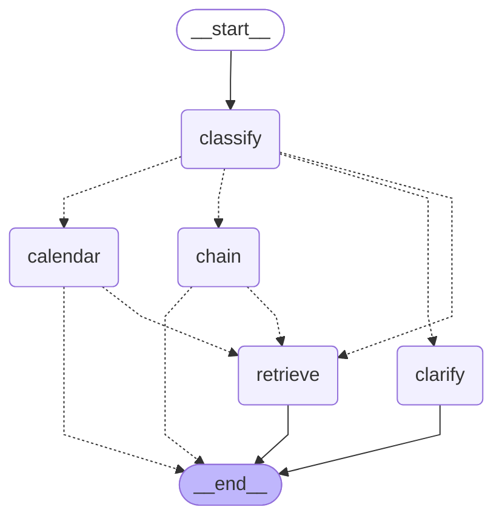

# Architecture: the router graph (Phase 3, step 4a)

The graph is built with LangGraph (`src/cta/graph/build.py`, `langgraph==1.2.14`, reason in `docs/decisions.md`). It is only used when `router.mode` is `"on"`;
with `"off"` (the default) `cta.answer.answer` runs directly, exactly as before. The diagram below is generated from the compiled graph
(`build_graph(...).get_graph().draw_mermaid()`) and a test checks that it is still the current one. Dotted arrows are conditional edges.

## What each node does

- **classify**: one model call (the answer model, temperature 0, JSON) returning `{"intent": "calendar" | "other", "term_mention": ...}`. A failed or unusable reply counts as `other` (the old pipeline must not be blocked by the router).
- **calendar** (conditional edge from `classify` when the intent is `calendar`):
  1. `terms.resolve_term` (plain code) turns the words the student used into a calendar: explicit term, season resolved against `eval.today`, no mention (the current term, stated in the answer), or an unsupported term (no calendar). An unsupported label is searched in the event text of every row (the q73 pattern); no match means abstain with the Registrar contact.
  2. `select.select_rows` (one model call) chooses row ids from the term's rows (link rows removed). Ids outside the pool are dropped and counted.
  3. `render.render_rows` (plain code, the only code that writes dates) writes the answer from the row fields and numbers the rows `[1]`, `[2]` ... as sources.
  - A valid empty selection for a supported term goes on to **retrieve** (Amendment 1). A failed or malformed selector call, an unsupported term with no usable row, or a selection whose ids are all outside the pool abstains (`ABSTAIN: ...` plus the Registrar contact).
- **chain** (step 4b; `router.chain` is `on` by default since step 4b-final, and `off` removes the third classifier intent so this node is unreachable; with it on the classifier has a third intent, `prerequisite`): `chain.extract_course` takes one course code, two or three course codes (step 2; only with the code renderer), or one exact unique course title from the question (else the question falls through to **retrieve**, route `chain_fallthrough`; four or more codes fall through too); a code with no record in the four departments abstains; otherwise the `prerequisite_chain` LangChain `@tool` walks the catalog prerequisite text (plain, deterministic code: breadth-first, depth at most 4, at most 15 courses, exclusions not followed, UNPARSED text verbatim) and a chain answer step writes the answer from the numbered course records (route `chain`).
- **retrieve**: the existing pipeline, unchanged (`cta.answer.answer`: vector top 20, rerank, top 5, abstain threshold, answer model).

## Routes written to `request_logs` (columns `route` and `router`)

`calendar`, `other`, `abstain` (the calendar node refused, or the chain node found no record), `calendar_fallthrough` (the calendar node found no row and retrieve answered), `chain`, `chain_fallthrough`. The `router` column holds the classifier and selector tokens, cost and latency, the invalid ids and the weekday mismatches.

Steps 4b (prerequisite chain) and 4c (contact lookup) add tool nodes next to `calendar`.

## Selector versions (step 4a-2)

The graph above is unchanged. The calendar node's selector has two versions (`router.selector`, default 2): version 1 chooses from the rows of the resolved term; version 2 (default) chooses from the rows of all three calendars, each line showing its term, with a stricter prompt, so a question like "register next spring" can use rows that sit in the Fall 2026 calendar. The unsupported-term path always uses version 1. The renderer names each row's own calendar in its source line.

## Contact line (step 4c)

After the graph, `Router.answer` calls `cta.graph.contact.add_contact` when `router.contacts` is `on` (default). If the final answer is an abstention it appends one plain-code line, `Contact <name>: <email>, <phone>.`, for the office chosen by the rules in `docs/step4c-plan.md`; the graph itself is unchanged. The route and the office are in `request_logs.router` (`contact_office`).

## Chain answer (chain layout, 2026-10-13)
With `router.chain_render: "code"` (default since the pre-registered keep rule passed, `docs/chain-layout-results.md`) the chain node writes its answer with `cta.graph.chain_render`: plain code, no model call after the classifier; one block per course ("CODE — Title [n]", "Courses named", "Catalog says" verbatim), fixed sentences for exclusions, unreadable text, codes without a record and a cut chain. A catalog text that holds markup characters makes the renderer raise, and the node then uses the model path (`chain_render: "model"` is also the explicit fallback). The graph itself is unchanged.

### Two or three courses in one question (step 2)
`extract_course` returns status `codes` for two or three distinct codes. `chain.combined_chain` walks them with `walk_many`: one visited set, one cap of 15 courses (room is kept for the asked courses still to come), the usual depth limit. A course reached from two asked courses stays in the section of the first; later sections say "CODE is already shown above." The renderer writes a heading "Prerequisites for CODE" per asked course, then that course's blocks, numbers running on across the answer; an asked code with no record gets its own sentence and the others are still shown; if no code has a record the answer is the usual abstention. With `chain_render: "model"` or on an unsafe catalog text, several-course questions fall through to retrieval as in 4b. One-course answers are byte-identical to before (`tests/fixtures/chain_single_render_sha256.json`).
