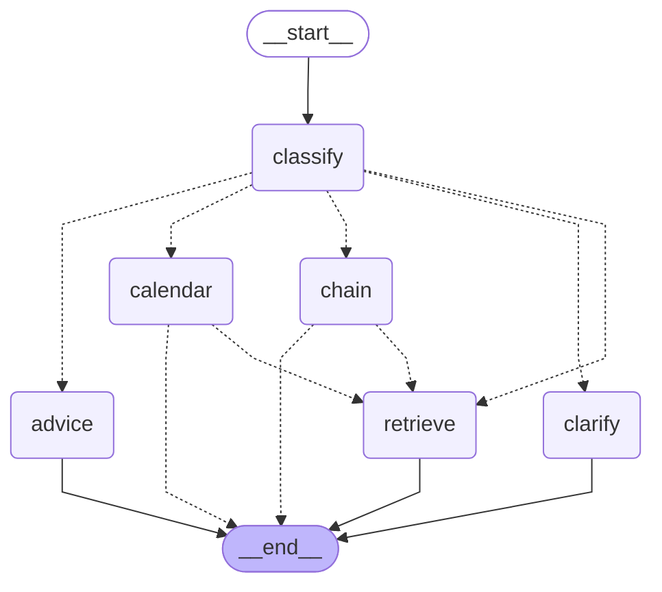

# Architecture: the router graph and the API layer

Last checked against the code on 2026-10-16 (read from `src/cta/graph/build.py`, `src/cta/answer.py`, `src/cta/api/app.py`, `src/cta/api/screen.py`, `src/cta/api/guard.py` and `config/models.yaml`, not copied from other docs).

The graph is built with LangGraph (`src/cta/graph/build.py`, `langgraph==1.2.14`, reason in `docs/decisions.md`). It is used when `router.mode` is `"on"`, which is the default in `config/models.yaml` (since step 4a-2); with `"off"` (`CTA_ROUTER_MODE=off`) `cta.answer.answer` runs directly, exactly as before. The API refuses to start with the router off. The diagram below is generated from the compiled graph
(`build_graph(...).get_graph().draw_mermaid()`) and a test checks that it is still the current one. Dotted arrows are conditional edges.

**Two layers.** The *pipeline* is everything inside the graph plus the contact line; the eval runner calls it. The *API layer* (`src/cta/api/`) wraps the pipeline for the web page and is **not** part of the eval runner (see the last section).

## What each node does

- **classify**: one model call (the answer model, temperature 0, JSON) returning `{"intent": "calendar" | "prerequisite" | "other", "term_mention": ...}` (`prerequisite` only when `router.chain` is on). A failed or unusable reply counts as `other` (the old pipeline must not be blocked by the router). The edge out of `classify` (`after_classify`) checks, in this order: **CLARIFY** (`clarify.needs_clarification`) -> `clarify`; **NO ADVICE** (`advice.needs_advice_rules`) -> `advice`; intent `prerequisite` -> `chain`; intent `calendar` -> `calendar`; everything else -> `retrieve`.
- **clarify** (plain code, no model call after the classifier): a short generic deadline question (at most 8 words, a cue such as "deadline" or "due date", no topic word, course code or department; or exactly "when is it due") gets a fixed question back, route `clarify`, no sources, no contact.
- **advice** (NO ADVICE, `src/cta/graph/advice.py`): a question that asks for a judgment (an advice cue such as "should I", "what would you do", "which is better", "your advice", plus an action word) is not answered with a verdict. The node searches with a fixed rule query (the student's text is not used), writes the rules from the sources with the answer model (`advice_max_output_tokens` 1000), and adds the calendar rows of the matched actions rendered by code. Route `advice`; if no source covers the action the usual abstention comes back.
- **calendar** (conditional edge from `classify` when the intent is `calendar`):
  1. `terms.resolve_term` (plain code) turns the words the student used into a calendar: explicit term, season resolved against `eval.today`, no mention (the current term, stated in the answer), or an unsupported term (no calendar). An unsupported label is searched in the event text of every row (the q73 pattern); no match means abstain with the Registrar contact.
  2. `select.select_rows` (one model call) chooses row ids from the term's rows (link rows removed). Ids outside the pool are dropped and counted.
  2a. **Drop-family rule** (`clarify.py`, casual round; it was `drop_family.py`): for a supported term, a question with a date cue about dropping or withdrawing and no qualifier (no grade of W or WD, "without", refund, percent, tuition, add, after, before) skips the selector and lists the three grade-related rows of the term (found by their event text). No model call.
  3. `render.render_rows` (plain code, the only code that writes dates) writes the answer from the row fields and numbers the rows `[1]`, `[2]` ... as sources.
  - A valid empty selection for a supported term goes on to **retrieve** (Amendment 1). A failed or malformed selector call, an unsupported term with no usable row, or a selection whose ids are all outside the pool abstains (`ABSTAIN: ...` plus the Registrar contact).
- **chain** (step 4b; `router.chain` is `on` by default since step 4b-final, and `off` removes the third classifier intent so this node is unreachable; with it on the classifier has a third intent, `prerequisite`): `chain.extract_course` takes one course code, two or three course codes (step 2; only with the code renderer), or one exact unique course title from the question (else the question falls through to **retrieve**, route `chain_fallthrough`; four or more codes fall through too); a code with no record in the four departments abstains; otherwise the `prerequisite_chain` LangChain `@tool` walks the catalog prerequisite text (plain, deterministic code: breadth-first, depth at most 4, at most 15 courses, exclusions not followed, UNPARSED text verbatim) and a chain answer step writes the answer from the numbered course records (route `chain`).
- **retrieve**: the existing pipeline (`cta.answer.answer`): vector top 20, LLM rerank (`retrieval.rerank: pool_a`), top 5 to the answerer, abstain when the best vector similarity is under `answer.abstain_threshold` (0.59), else the answer model. **Near-miss reply:** a below-threshold abstention whose best similarity is within `near_miss_margin` (0.04) under the cutoff lists up to two of the closest pages (a page only if its own similarity is at or above cutoff minus margin) instead of the bare refusal; it is still an abstention. **Experiment E1 (fallback query rewrite) is built but OFF** (`retrieval.fallback_rewrite: "off"`): when on, a plain retrieve question or a calendar fall-through that scored under the cutoff gets one rewrite call and a second search; it was rejected twice (`docs/decisions.md`, casual round), so this path does not run.

## Routes written to `request_logs` (columns `route` and `router`)

`calendar`, `other`, `abstain` (the calendar node refused, or the chain node found no record), `calendar_fallthrough` (the calendar node found no row and retrieve answered), `chain`, `chain_fallthrough`, `clarify`, `advice`. The `router` column holds the classifier and selector tokens, cost and latency, the invalid ids and the weekday mismatches.

Steps 4b (prerequisite chain) and 4c (contact lookup) add tool nodes next to `calendar`; CLARIFY and NO ADVICE add `clarify` and `advice` (see above).

## Selector versions (step 4a-2)

The graph above is unchanged. The calendar node's selector has two versions (`router.selector`, default 2): version 1 chooses from the rows of the resolved term; version 2 (default) chooses from the rows of all three calendars, each line showing its term, with a stricter prompt, so a question like "register next spring" can use rows that sit in the Fall 2026 calendar. The unsupported-term path always uses version 1. The renderer names each row's own calendar in its source line.

## Contact line (step 4c)

After the graph, `Router.answer` calls `cta.graph.contact.add_contact` when `router.contacts` is `on` (default). If the final answer is an abstention it appends one plain-code line, `Contact <name>: <email>, <phone>.`, for the office chosen by the rules in `docs/archive/step4c-plan.md`; the graph itself is unchanged. The route and the office are in `request_logs.router` (`contact_office`).

## Chain answer (chain layout, 2026-10-13)
With `router.chain_render: "code"` (default since the pre-registered keep rule passed, `docs/archive/chain-layout-results.md`) the chain node writes its answer with `cta.graph.chain_render`: plain code, no model call after the classifier; one block per course ("CODE — Title [n]", "Courses named", "Catalog says" verbatim), fixed sentences for exclusions, unreadable text, codes without a record and a cut chain. A catalog text that holds markup characters makes the renderer raise, and the node then uses the model path (`chain_render: "model"` is also the explicit fallback). The graph itself is unchanged.

### Two or three courses in one question (step 2)
`extract_course` returns status `codes` for two or three distinct codes. `chain.combined_chain` walks them with `walk_many`: one visited set, one cap of 15 courses (room is kept for the asked courses still to come), the usual depth limit. A course reached from two asked courses stays in the section of the first; later sections say "CODE is already shown above." The renderer writes a heading "Prerequisites for CODE" per asked course, then that course's blocks, numbers running on across the answer; an asked code with no record gets its own sentence and the others are still shown; if no code has a record the answer is the usual abstention. With `chain_render: "model"` or on an unsafe catalog text, several-course questions fall through to retrieval as in 4b. One-course answers are byte-identical to before (`tests/fixtures/chain_single_render_sha256.json`).

## Which paths run where

| Step | Layer | Runs in the eval runner? | Notes |
|---|---|---|---|
| input hygiene (control, bidi, zero-width characters removed, whitespace collapsed) | API | no | `api/screen.py` |
| Stage 1 guard: kill switch, rate limit, daily spend cap | API | no | `api/guard.py`; a blocked request is answered 200 with `answer_type: "guardrail"` |
| Stage 2 screens on the question: distress, bereavement, personal data (SSN-shaped, long digit runs), prompt injection, stress; names, e-mails, phone and ID numbers scrubbed | API | no | `api/screen.py`; fixed replies, no model call |
| language step (`guardrails.language_step`): one small call for a question that does not look English; `non_english: english_only` returns a fixed English notice | API | no | `api/language.py` |
| classify, clarify, advice, calendar (with the drop-family rule), chain, retrieve, near-miss reply | pipeline | yes | `graph/` and `answer.py` |
| contact line on an abstention (contact policy v2) | pipeline | yes | `graph/contact.py`, `router.contacts: "on"` |
| fallback query rewrite (E1) | pipeline | only if switched on | off in `config/models.yaml` |
| topic sentence for an abstention (two fixed templates, one extra model call) | API | no | `api/topic.py` |
| output checks: an abstention that names self-harm becomes the 988 reply; a key-shaped answer is replaced | API | no | `api/app.py` |
| request log row (redacted), feedback votes, optional LangSmith tracing (off by default) | API | no | `api/requestlog.py`, `api/tracing.py` |
| personal-account wording of an abstention, citations with URLs, contact as a card | API (`convert.py`) | no | formatting of the pipeline's result |

## Route values

`request_logs.route` (pipeline): `calendar`, `other` (retrieve), `abstain` (the calendar node refused, or the chain node found no record), `calendar_fallthrough`, `chain`, `chain_fallthrough`, `clarify`, `advice`. The API response maps these to `calendar | chain | retrieve | clarify | guardrail` (`api/convert.py`: `advice`, `other` and the two fall-throughs show as `retrieve`; `abstain` shows as `calendar` or `chain` by which node refused); a guardrail reply has `answer_type: "guardrail"` and the reason in `how_found.route_detail`.
